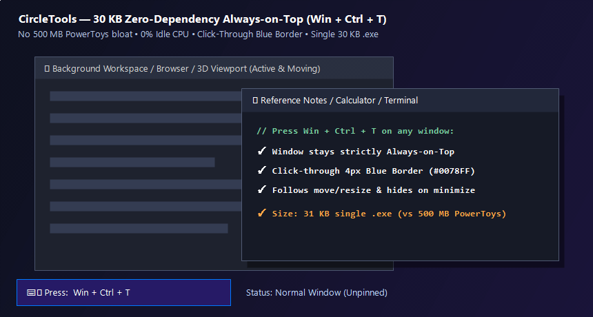

<div align="center">

# 📌 CircleTools — 30 KB Always-on-Top for Windows (`Win + Ctrl + T`)

**Pin any Windows 10/11 window on top of all others with a single shortcut (`Win + Ctrl + T`) and a click-through `#0078FF` blue border — without installing 500 MB of bloatware.**

**TR:** *Windows'ta aktif pencereyi tek kısayolla (`Win + Ctrl + T`) **Her Zaman Üstte (Always on Top)** sabitleyin; sabitlenen pencerenin etrafında tıklamaları geçiren **mavi bir çerçeve** görünür. Yalnızca ~30 KB tek `.exe`, sıfır kurulum, %0 boşta CPU/RAM.*

[](https://github.com/thezencirs/CircleTools/releases/latest)
[](#why-circletools-instead-of-500-mb-bloat)
[-success)](#build-from-source-zero-sdk-required)
[](#)
[](LICENSE)
[](https://github.com/thezencirs)

<br/>



</div>

---

## ⚡ Why CircleTools Instead of 500 MB Bloat?

Most Windows users only want **`Win + Ctrl + T` (Always on Top)** with a clean visual border so they don't forget which window is pinned. Installing a 500+ MB suite with 15 background services just to pin a calculator, reference image, or terminal window is overkill.

| Feature | **📌 CircleTools** | Microsoft PowerToys | DeskPins | Custom AHK Script |
| :--- | :---: | :---: | :---: | :---: |
| **Install / Binary Size** | **~31 KB (Single `.exe`)** | ~500–800 MB | ~400 KB | ~3 MB runtime + script |
| **Shortcut** | **`Win + Ctrl + T`** | `Win + Ctrl + T` | Drag pin icon manually | Custom |
| **Click-Through Visual Border** | **✅ Yes (`#0078FF` + inner hairline)** | ✅ Yes | ❌ No border | ❌ No border |
| **Idle CPU / Background Services** | **0% CPU (1 tiny tray process)** | 10+ background processes | 1 process (outdated DPI) | 1 interpreter process |
| **Per-Monitor High-DPI (125%–200%)** | **✅ Native DWM Bounds** | ✅ Yes | ⚠️ Blurry / offset | ⚠️ Manual |
| **External Runtime Required** | **None (Built into Windows)** | .NET Desktop Runtime + WebView2 | None | AutoHotkey Runtime |
| **SHA-256 Verified Self-Updater** | **✅ Built-in** | ✅ Built-in | ❌ No | ❌ No |

---

## 🚀 Quick Install & Usage

### Option 1 — Direct Single `.exe` (Zero Install)
1. Download **[`CircleTools.exe`](https://github.com/thezencirs/CircleTools/releases/latest)** (or `CircleTools-v1.0.0-win.zip`) from **[Releases](https://github.com/thezencirs/CircleTools/releases/latest)**.
2. Double-click `CircleTools.exe` — it runs silently in your Windows system tray.
3. Click any window and press **`Win + Ctrl + T`** to pin it on top (marked by a glowing blue border). Press **`Win + Ctrl + T`** again to unpin.

### Option 2 — One-Line PowerShell Install & Start
```powershell
irm https://github.com/thezencirs/CircleTools/releases/latest/download/CircleTools.exe -OutFile "$HOME\Desktop\CircleTools.exe"; Start-Process "$HOME\Desktop\CircleTools.exe"
```

---

## ✨ Key Features (Özellikler)

- **Instant `Win + Ctrl + T` Toggle:** Pin or unpin the active foreground window in milliseconds (`MOD_WIN | MOD_CONTROL | MOD_NOREPEAT`).
- **Click-Through DWM Blue Border:** Draws a crisp 4px `#0078FF` border with a 1px inner contrast line around every pinned window using `DwmGetWindowAttribute(DWMWA_EXTENDED_FRAME_BOUNDS)`. Mouse clicks pass right through (`WS_EX_TRANSPARENT | WS_EX_LAYERED | WS_EX_TOOLWINDOW`), and the border automatically tracks window movement, hides when minimized, and cleans up when closed.
- **Multiple Pinned Windows:** Pin as many windows as you need simultaneously; right-click the tray icon anytime to see the live count or **Unpin All** with one click.
- **Start with Windows:** Toggle auto-start on boot directly from the system tray menu (`HKCU\Software\Microsoft\Windows\CurrentVersion\Run`).
- **SHA-256 Verified In-App Updater:** Checks GitHub Releases once a day (or on demand) and verifies `SHA256SUMS.txt` before updating.

---

## 🛠️ Build from Source (Zero SDK Required)

No Visual Studio, NuGet, or external SDK installation is required. CircleTools compiles in under 1 second using the native C# compiler (`csc.exe`) shipped inside every Windows 10/11 installation:

```powershell
git clone https://github.com/thezencirs/CircleTools.git
cd CircleTools
powershell -ExecutionPolicy Bypass -File build.ps1
```

---

## 🧩 Part of the Circle Zero-Bloat Windows Suite (`by @thezencirs`)

If you like **CircleTools**, check out the rest of our ultra-lightweight, zero-bloat Windows studio tools crafted for developers, architects, and creators:

| Tool | Size | What It Does | Shortcut / Highlight |
| :--- | :---: | :--- | :--- |
| 📌 **[CircleTools](https://github.com/thezencirs/CircleTools)** | `~31 KB` | Pin any window **Always-on-Top** with a click-through blue border | **`Win + Ctrl + T`** |
| 🪢 **[CircleLine](https://github.com/thezencirs/CircleLine)** | `~85 KB` | **0-RAM Pendulum-Physics Desktop Clothesline**: pin Polaroids, extract 5-color `#HEX` palettes, and auto-convert `.webp`/`.heic` to `.png` when dragged into **3ds Max / AutoCAD / Revit / Photoshop** | **`Ctrl + Shift + L`** / **`Ctrl + Shift + X`** |
| 🖼️ **[CircleRef](https://github.com/thezencirs/CircleRef)** | `~55 KB` | **Infinite-Canvas Reference Image Board** (open-source PureRef alternative) with global Always-on-Top and Click-Through Lock | **`Ctrl + Alt + T`** / **`Ctrl + Alt + L`** |
| 📦 **[CircleRar](https://github.com/thezencirs/CircleRar)** | `~45 KB` | **Clean Windows 10/11 Archive Manager** (`RAR`, `ZIP`, `7z`, `TAR`, `ISO`) with single-line `CircleRar ▸` context menu & AES-256 encryption | Explorer Right-Click |
| 🎬 **[CircleMixRecord](https://github.com/thezencirs/CircleMixRecord)** | Studio | **Dual-Canvas (16:9 + 9:16) GPU Screen Recorder**, **Circle Meet** (6-digit PIN live screen share & remote control) & **Circle Edit 60 FPS Timelapse Studio** | **`Ctrl + Shift + R`** / **`Alt + Q`** |

---

## ⚖️ License & Legal Notice

- **Author:** [**@thezencirs**](https://github.com/thezencirs)
- **License:** 100% original code released under the [MIT License](LICENSE) (`Copyright (c) 2026 thezencirs`).
- **Disclaimer:** CircleTools is an independent open-source project and is not affiliated with Microsoft Corporation or any third-party trademark holder.

<div align="center">
  <b>If CircleTools saved you from installing 500 MB of bloatware, please consider giving this repo a ⭐ Star!</b>
</div>
